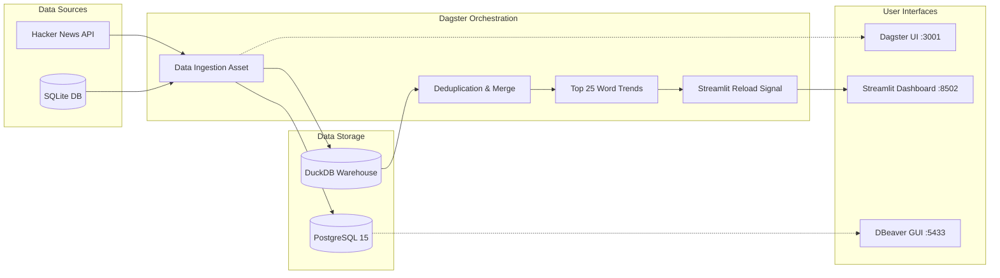

# 🚀 Hacker News Real-Time ETL Pipeline & Analytics Dashboard

A modern, containerized end-to-end Data Engineering pipeline built with **Dagster**, **DuckDB**, **PostgreSQL**, **SQLite**, and **Streamlit**.

This project ingests trending news and stories from the **Hacker News REST API** and local database sources, cleans and deduplicates the data, computes trending analytical metrics (like top keywords), stores everything in persistent databases, and presents real-time analytics in an interactive web dashboard.

---

## 📌 Architecture Overview



---

## ✨ Features

- **Multi-Source Ingestion**: Ingests data concurrently from Hacker News Firebase REST API and relational SQLite tables.
- **Dual-Database Storage**:
  - **PostgreSQL 15 Container**: Relational transactional database for direct inspection via SQL GUI clients (DBeaver, DataGrip, TablePlus).
  - **DuckDB**: Fast, in-process columnar analytical data warehouse for lightning-fast queries and deduplication.
- **Asset-Based Orchestration**: Built with modern Dagster Software-Defined Assets (SDAs), schedules, and automatic dependency tracking.
- **Background Scheduler (Dagster Daemon)**: Automatically handles hourly and 15-minute cron pipelines.
- **Real-Time Streamlit Dashboard**: Displays live bar charts of trending tech topics and auto-refreshes when new pipeline runs finish.
- **Full Dockerization**: Everything runs out-of-the-box with `docker compose` with persistent volumes.

---

## 🖥️ Live Service Endpoints

Once the containers are running, you can access the following services in your browser or database tool:

| Service | URL / Host | Description |
| :--- | :--- | :--- |
| **Dagster Web UI** | [http://localhost:3001](http://localhost:3001) | View pipelines, asset dependency graph, run history, and trigger runs |
| **Streamlit Dashboard** | [http://localhost:8502](http://localhost:8502) | Real-time trending keyword analytics visualization |
| **PostgreSQL Database** | `localhost:5433` | Database service accessible via DBeaver / psql |

---

## ⚡ Quick Start Guide

### 1. Prerequisites
- [Docker](https://www.docker.com/products/docker-desktop/) and Docker Compose installed.
- (Optional) [DBeaver Community Edition](https://dbeaver.io/) to view PostgreSQL tables.

### 2. Launch Everything with Docker Compose

Clone the repository and run:

```bash
# 1. Start all services in detached mode (builds if not already built)
docker compose up --build -d

# 2. Check that both containers are running and healthy
docker compose ps
```

That's it! Both `dagster_etl_pipeline` and `postgres_db` will start up, initialize the database tables, and run in the background.

---

## 🛠️ Complete Docker Command Cheat Sheet

Here are all the essential commands you will need for managing and monitoring the project:

### Starting & Stopping

```bash
# Start all containers in the background
docker compose up -d

# Rebuild and start after code or dependency changes
docker compose up --build -d

# Stop all containers (keeps volumes and database data intact)
docker compose stop

# Stop and remove containers and network (data remains safe in volumes)
docker compose down

# Complete teardown: remove containers, network, and persistent volumes (Fresh Reset)
docker compose down -v
```

### Checking Status & Logs

```bash
# View status and ports of running containers
docker compose ps

# Follow live output logs for all services
docker compose logs -f

# View logs specifically for Dagster & Streamlit app
docker compose logs -f dagster-etl

# View logs specifically for the PostgreSQL database container
docker compose logs -f postgres-db
```

### Running Pipeline Directly from Terminal

You can trigger pipeline executions without opening the browser:

```bash
# Run the Hacker News API Ingestion Pipeline (fetches 100 live stories)
docker exec dagster_etl_pipeline dagster job execute -m orchestration -j api_pipeline_job

# Run the SQLite Ingestion Pipeline
docker exec dagster_etl_pipeline dagster job execute -m orchestration -j sqlite_pipeline_job
```

### Database Inspection Commands (PostgreSQL CLI)

```bash
# Open interactive PostgreSQL shell inside container
docker exec -it postgres_db psql -U postgres -d hackernews_db

# Quickly count records in PostgreSQL
docker exec -i postgres_db psql -U postgres -d hackernews_db -c "SELECT COUNT(*) FROM api_ingest;"

# View top 5 latest ingested stories
docker exec -i postgres_db psql -U postgres -d hackernews_db -c "SELECT id, title, score FROM api_ingest ORDER BY id DESC LIMIT 5;"
```

---

## 🎯 How to Run the Pipeline in Dagster Web UI

1. Open **[http://localhost:3001](http://localhost:3001)** in your browser.
2. In the left navigation, click on **Jobs**.
3. Select **`api_pipeline_job`** (or `sqlite_pipeline_job`).
4. Click on the **Launchpad** tab at the top right.
5. Hit the blue **"Launch Run"** button.
6. Watch the real-time execution DAG turn green step-by-step:
   - `topstories_api_ingest` ➔ `common_table` ➔ `most_frequent_title_words` ➔ `streamlit_dashboard`
7. Check **Streamlit** at [http://localhost:8502](http://localhost:8502) to see updated word trends!

---

## 🗄️ Connecting with DBeaver (Database GUI)

To inspect tables, run custom SQL queries, and monitor live ingested data in DBeaver:

1. Open **DBeaver** and click on **New Database Connection** (the plug 🔌 icon).
2. Choose **PostgreSQL** (Elephant 🐘 icon) and click **Next**.
3. Fill in the connection settings:

   | Field | Value |
   | :--- | :--- |
   | **Host** | `localhost` |
   | **Port** | `5433` |
   | **Database** | `hackernews_db` |
   | **Username** | `postgres` |
   | **Password** | `postgrespassword` |

4. Click **Test Connection** (download driver if prompted) ➔ **Finish**.
5. Navigate to:  
   `hackernews_db` ➔ `Schemas` ➔ `public` ➔ `Tables` ➔ `api_ingest`
6. Press **`F5`** (Refresh) to see live ingested data!

---

## 📂 Project Directory Structure

```text
python-etl-daily-news/
├── Dockerfile                  # Container definition for Dagster & Streamlit app
├── docker-compose.yml          # Multi-container orchestration (App + Postgres DB)
├── entrypoint.sh               # Startup script verifying and auto-seeding DBs
├── supervisord.conf            # Supervisor managing Webserver, Daemon, and Streamlit
├── requirements.txt            # Python dependencies (Dagster, DuckDB, psycopg2, etc.)
├── README.md                   # Project documentation
├── dagster_tutorial/
│   ├── dagster.yaml            # Dagster instance configuration
│   ├── setup.py                # Python package metadata
│   ├── docker_setup/
│   │   ├── init_sqlite.py      # SQLite schema and dummy seed script
│   │   ├── duckdb_setup.py     # DuckDB warehouse initialization
│   │   └── init_postgres.sql   # PostgreSQL initial schema & seed SQL
│   ├── data/                   # Persistent storage for SQLite & DuckDB files
│   ├── logs/                   # Persistent storage for Dagster run history
│   ├── frontend/
│   │   └── streamlit_app.py    # Streamlit real-time interactive word trend dashboard
│   └── orchestration/
│       ├── __init__.py         # Dagster Definitions, jobs, and schedule registry
│       ├── assets/
│       │   └── __init__.py     # Software-Defined Assets (Ingestion, Merge, Analytics)
│       └── resources/
│           └── __init__.py     # Database resources (PostgresResource, SqliteResource)
```

---

## 💡 Troubleshooting & Common Tips

- **Port already in use error on 5432?**
  - We have mapped PostgreSQL container to port **`5433`** on your host machine to prevent conflicts with any local PostgreSQL instance you might already have running.
- **Want to clear all data and start completely fresh?**
  - Run `docker compose down -v`. This removes the containers and the Docker volume. On your next `docker compose up -d`, initial schemas will be cleanly re-created.
- **Are code changes reflected immediately?**
  - Yes! Both `dagster_tutorial/orchestration` and `dagster_tutorial/frontend` folders are bind-mounted inside the container, so code edits are immediately picked up without needing an image rebuild.
